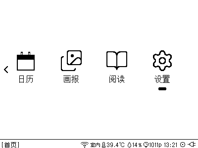
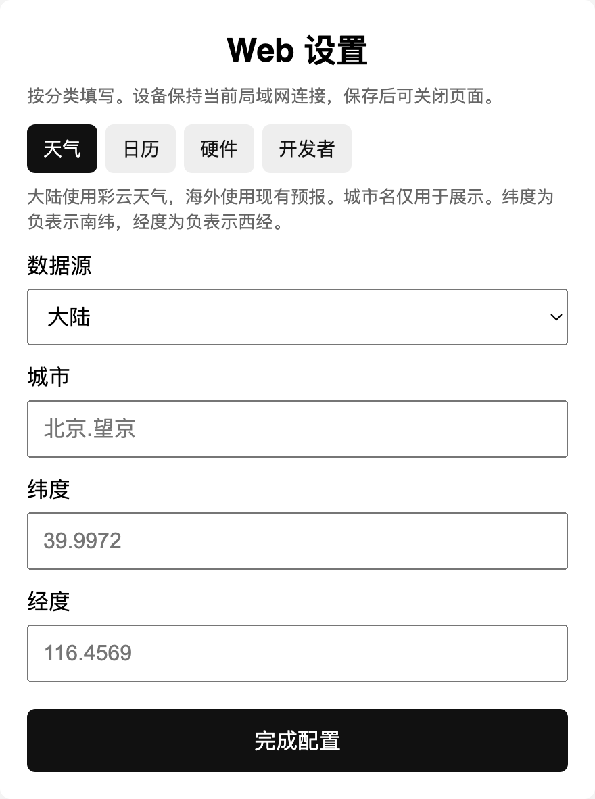

# 调试服务与说明书截图

使用说明书是 `docs/index.html`。本文只给开发和改说明书用，不要把调试端口、开发者密码或调试接口写进说明书。

开发者选项在 **设置 → Web 设置** 的「开发者」标签里，密码是 `TT_DEV_PASSWORD`（`src/Base/TTConfigServer.h`，当前为 `bagemima`）。这个标签只在局域网门户里出现，热点门户会把它去掉。勾选后随「完成配置」保存，重启仍然有效。

| 选项 | 作用 |
|------|------|
| 长按上键截图 | 长按「上」把当前画面存进 LittleFS `/shots`。未勾选时长按没有效果 |
| 关闭气压计 | 状态栏不再显示气压 |
| 启用调试服务 | 在 8080 端口提供按键和远程截图，并保持 Wi-Fi |

勾选「长按上键截图」后，同一页有「截图下载与删除」。下载不需要密码，删除和清空需要开发者密码。热点门户不提供这些地址，会返回 404。

## USB 串口日志

USB 日志不需要打开「启用调试服务」。插上数据线就能看。调试服务走局域网 8080，和串口是两条路，可以同时开着。

板子上的串口芯片是 CH340，`pio device list` 里厂商号是 `1A86:55D4`，名字一般是 `/dev/cu.usbserial-…`。在仓库根目录执行：

```bash
pio device list
pio device monitor
```

`pio device monitor` 会读 `platformio.ini`：波特率 115200，`monitor_rts` 和 `monitor_dtr` 都是 0，`monitor_raw` 打开。必须在仓库根目录运行，这两项才会生效。不要用 `screen`、`cu` 或会拉高 DTR/RTS 的串口工具。CH340 上 DTR 一变，ESP32 就会复位，日志会从 `00:00:00` 重新打启动过程。

同一时间只能有一个程序占用这个口。Cursor 里如果已经有 PlatformIO 的 Serial Monitor 任务，再开一个会提示端口忙。烧录前先停掉监视器，把口让出来。监视器本身不要去拨 DTR/RTS。

在 Cursor 里用集成终端或 PlatformIO 的 Monitor 任务打开。`pio device monitor` 需要一个真正的交互终端，不能套在管道后面跑。结束时按 Ctrl+C。

连上后会持续刷日志。时钟有效时一行像这样：

```text
[2026-10-28 15:10:01.123][I][TTSleepService.cpp:104]: Sleep: wait, not idle
```

方括号里依次是本地时间、级别、文件和行号。级别默认到 Info：`[E]` 错误、`[W]` 警告、`[I]` 信息。Debug 和 Verbose 默认不打。时钟还没同步时，时间位置改成从启动算起的 `时:分:秒.毫秒`。

## 调试服务

启用后，设备会尽量保持 STA 连接。未连接时大约每 15 秒重试一次。串口会出现 `Debug: listening http://<ip>:8080`。

进入阅读（书架）时，平时会在空闲后卸载 Wi-Fi 驱动。调试服务开着则不会卸载，日志是 `WiFi: keep driver, debug server is on`。天气、日历、画报本身不会因为进入页面而卸载驱动。

调试服务占用 8080，可以和 Web 设置、WiFi 传书同时开着。Web 设置和传书都占用 80，两者不能同时开。

调试页是 `http://<ip>:8080/`，上面有按键按钮和「截图」。接口也可以直接调用：

```text
GET 或 POST /key?key=up|down|center&gesture=click|double|long
GET /shot
```

`key` 还接受 `right`（等于 `up`）和 `left`（等于 `down`）。`gesture` 还接受 `double_click`、`long_press`。按键成功返回 `{"ok":true,"key":"...","gesture":"..."}`，参数不对返回 400。

按键和说明书里的拨轮一致：

| 调试参数 | 说明书 | 作用 |
|----------|--------|------|
| `up` + `click` | 上拨 | 下一项 |
| `down` + `click` | 下拨 | 上一项 |
| `center` + `click` | 中键 | 进入或确认 |
| `down` + `long` | 长按「下」 | 返回上一页 |
| `up` + `long` | 长按「上」 | 本地截图（须已勾选「长按上键截图」） |
| `center` + `long` | 长按「中键」 | 交给当前页，例如强制刷新 |

`/shot` 会挡住 Wi-Fi 任务，直到这一帧画完并传完。完成前不要再发 `/key` 或 `/shot`。一次大约 7–11 秒，`curl --max-time` 至少给 20 秒。成功时是 `image/bmp`，400×300、1 位、15662 字节，带 `Cache-Control: no-store`。失败时正文是「截图失败」。远程截图不依赖「长按上键截图」，文件写在 `/tmp/debug-shot.bmp`，按 1KB 一块写入。

用调试服务改说明书时：

- 先 `GET /shot` 确认当前画面，再按中键。不要在焦点不明时进入 **联网设置**、**重启** 或 **检查更新**。
- **联网设置** 会打开热点并断开 STA，8080 的局域网地址随即失效。这一页用设备上的长按截图，回到局域网后再下载。
- 调试请求不占用串口。USB 日志的打开方式见上面「USB 串口日志」。烧录才需要让出串口。

## 本地截图

勾选「长按上键截图」后，长按「上」会全屏重绘并保存。成功时屏幕提示「已截图」，LittleFS 剩余空间不足 256KB 时提示「空间不足」。最多 32 张。

文件名是 `YYYYMMDD_HHMMSS_<页面名>.bmp`。时钟无效时改为 `m<millis>_<页面名>.bmp`。同一秒重名会在后面加 `_2`、`_3`。

下载要先进入 **设置 → Web 设置**，让局域网门户开着：

```bash
curl -fsS -o shot.bmp --get \
  --data-urlencode "name=20261028_131751_联网设置.bmp" \
  "http://192.168.66.128/shots/file"
```

列表页是 `http://<ip>/shots`，全部打包是 `http://<ip>/shots.zip`。

## 放进说明书

截图紧挨在它说明的那句文案下面。设备画面和网页画面用不同的框。

设备画面转成 PNG 后放到 `docs/shots/`，套进 `docs/DeviceFrame.svg`：

```bash
sips -s format png shot.bmp --out docs/shots/menu-settings.png
```

```html
<figure class="device">
  <div class="canvas">
    <div class="hole">
      
    </div>
    
  </div>
</figure>
```

网页画面不要套设备框。在电脑浏览器里打开页面，截白色卡片（页面里的 `.box`），用 `webshot`：

```html
<figure>
  
</figure>
```

当前两类网页：

| 页面 | 怎么打开 | 说明书里的图 |
|------|----------|----------------|
| WiFi 传书 | 书架进入传书后打开 `http://<ip>/`，标题是「上传电子书」 | `shots/book-transfer.png`，设备上的二维码页另存 `shots/book-transfer-device.png` |
| Web 设置 | **设置 → Web 设置**，同一地址，标题会变成「Web 设置」 | 天气、日历各一张：`shots/web-weather.png`、`shots/web-calendar.png` |

局域网门户默认停在「天气」。日历标签要点开再截。日历密码会由页面填回输入框，说明书图片里不要留下密码，密码框保持空白。硬件和开发者标签出现在截图上没有关系，说明书正文不解释这两项。

IDE 浏览器视口如果裁切卡片，用本机 Chrome 按卡片高度整页截取再裁掉灰边。天气卡片大约 980 CSS 像素高，日历大约 820。`--force-device-scale-factor=2` 时宽度 480 会得到适合 `webshot`（最大约 440px）的清晰图。
